# Proyecto 2 - BanTech GT

Manual técnico de la infraestructura financiera y alta disponibilidad

## 1) Datos generales

- **Curso:** Redes de Computadoras 1
- **Estudiantes:**
  - Lourdes Beatriz Orozco Pérez - 202403228
  - Astrid Vanesa Kim Ortiz - 202300685
  - Jaime David Velásquez Romero - 202405109
- **Semestre:** 2S-2026
- **Grupo:** 11
- **Carnet del coordinador:** `202403228`
- **Archivo Packet Tracer:** `Proyecto2_BanTechGT.pkt`

### 1.1 Parámetros de identificación

| Variable | Valor | Origen |
|---|---|---|
| `XX` | `28` | Últimos dos dígitos del carnet del coordinador |
| `Y` | `1` | Último dígito del grupo 11 |
| Dominio VTP | `bantech28` | `bantechXX` |
| Password VTP | `cisco` | Enunciado |

## 2) Objetivo

Diseñar e implementar en Cisco Packet Tracer la red nacional de **BanTech GT**, cumpliendo:

- Backbone redundante con fibra, Ethernet y serial
- Redistribución entre **OSPF, EIGRP 28, RIPv2 y rutas estáticas**
- Segmentación por VLAN y subneteo **VLSM**
- Alta disponibilidad: **HSRP, Rapid PVST+ y EtherChannel LACP**
- Conectividad extremo a extremo entre las cuatro sedes

## 3) Arquitectura implementada

La red se divide en un núcleo y cuatro sedes de borde:

1. **Backbone Core:** `R-CORE1`, `R-CORE2`, `R-CORE3` (2911)
2. **Occidente:** agencia comercial, Router-on-a-Stick + VTP
3. **Norte:** autorización de créditos, triángulo L2 + Rapid PVST+
4. **Oriente:** centro legado, `MS1`/`MS2` + HSRP
5. **Central / Data Center:** estáticas + EtherChannel LACP

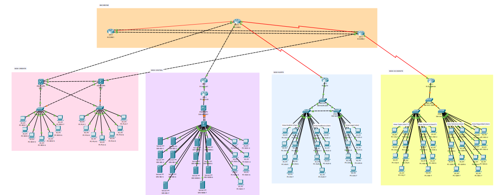

### 3.1 Asignación de protocolos

| Sede | Protocolo | Justificación |
|---|---|---|
| Oriente | OSPF 1 área 0 | Sede corporativa crítica; encaja con el núcleo jerárquico |
| Norte | EIGRP AS 28 | Autorización de créditos; convergencia rápida (`28` = `XX`) |
| Occidente | RIPv2 | Agencia regional; operación simple y administrable |
| Central / DC | Rutas estáticas | Aislamiento por seguridad; `R-Central1` las anuncia al backbone |

### 3.2 Puntos de redistribución

- **`R-CORE2`:** RIP ↔ OSPF
- **`R-CORE3`:** EIGRP ↔ OSPF
- **`R-Central1` (adicional):** estáticas del DC → OSPF

### 3.3 Medios del backbone

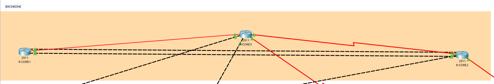

| Enlace | Medio | Uso |
|---|---|---|
| `R-CORE1 G0/0` y `G0/1` ↔ `R-CORE2` | Ethernet (2 `/30` redundantes) | Transporte local del núcleo |
| `R-CORE1 G0/0/0` ↔ `R-CORE3 G0/1/0` | Fibra Single-Mode (`GLC-LH-SM`) | Enlace de núcleo de mayor distancia |
| `R-CORE2 S0/0/0` ↔ `R-CORE3 S0/0/0` | Serial DCE/DTE | WAN remota |

El 2911 de Packet Tracer no acepta `channel-group`. La agregación obligatoria se implementó en el Data Center con 3560 (`Po10`, LACP). Entre CORE1 y CORE2 se dejaron dos enlaces Ethernet `/30` para no perder redundancia.

## 4) Equipos utilizados

| Hostname | Modelo en PT | Función |
|---|---|---|
| `R-CORE1`, `R-CORE2`, `R-CORE3` | Router-PT 2911 | Núcleo y redistribución |
| `R-Occidente`, `R-Norte` | Router-PT 2911 | Borde de sede + ROAS |
| `R-Central1` | Router-PT 2911 | Redistribuye estáticas al backbone |
| `R-Central2` | Router-PT 2911 | Acceso del DC (ROAS + default estática) |
| `MS1`, `MS2` | 3560-24PS | Gateways HSRP de Oriente |
| `SW-OCC-*`, `SW-NOR-*`, `SW-ORI-*` | 2960-24TT | Acceso y distribución L2 |
| `SW-DC-DIST`, `SW-DC-ACC` | 3560-24PS | EtherChannel LACP hacia servidores |

## 5) Tabla de VLANs

| Sede | VLAN | Nombre | Hosts requeridos | Fórmula |
|---|---:|---|---:|---|
| Occidente | 11 | Cajas | 45 | `1Y` |
| Occidente | 21 | Asesores | 30 | `2Y` |
| Occidente | 31 | Gerencia | 10 | `3Y` |
| Occidente | 41 | Seguridad | 12 | `4Y` |
| Norte | 51 | Analisis | 50 | `5Y` |
| Norte | 61 | Auditoria | 25 | `6Y` |
| Norte | 71 | Legal | 14 | `7Y` |
| Oriente | 81 | Boveda | 40 | `8Y` |
| Oriente | 91 | Plataforma | 60 | `9Y` |
| Central | 12 | Core_BD | 14 | `1Y+1` |
| Central | 22 | Web_Apps | 28 | `2Y+1` |
| Central | 32 | NOC | 10 | `3Y+1` |

En simulación se colocaron **7 hosts por área** (mínimo del enunciado).

Evidencia en `SW-OCC-DIST`: VLANs `11 Cajas`, `21 Asesores`, `31 Gerencia` y `41 Seguridad` creadas y con nombre explícito.

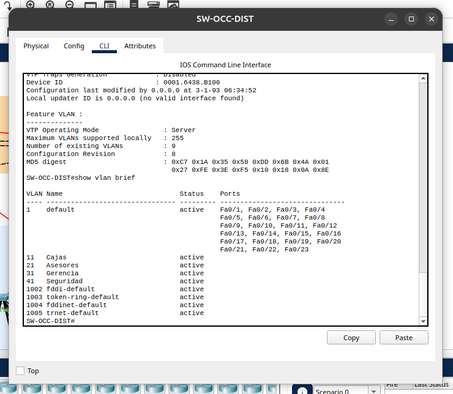

## 6) Plan de direccionamiento (VLSM)

Red base: `10.28.0.0/16` (`28` = `XX`).

**Método elegido: VLSM.** Las áreas no piden la misma cantidad de hosts (Cajas 45, Gerencia 10, Plataforma 60, enlaces P2P de 2 IPs). Con FLSM todas las VLAN usarían el bloque de la más grande (`/26`) y se desperdiciarían direcciones en Gerencia, Seguridad, Legal y NOC. VLSM asigna `/26`, `/27` o `/28` según hosts + red + broadcast + gateway, y `/30` en los enlaces punto a punto. Así se respeta el carnet (`10.28.0.0/16`) y no hay solapamiento.

### 6.1 Redes de usuario y servidores

| VLAN | Hosts req. | Prefijo | Red | Máscara | Rango usable | Broadcast | Gateway |
|---:|---:|---|---|---|---|---|---|
| 11 | 45 | `/26` | `10.28.0.0` | `255.255.255.192` | `.1` – `.62` | `10.28.0.63` | `10.28.0.1` |
| 21 | 30 | `/26` | `10.28.0.64` | `255.255.255.192` | `.65` – `.126` | `10.28.0.127` | `10.28.0.65` |
| 31 | 10 | `/28` | `10.28.0.128` | `255.255.255.240` | `.129` – `.142` | `10.28.0.143` | `10.28.0.129` |
| 41 | 12 | `/28` | `10.28.0.144` | `255.255.255.240` | `.145` – `.158` | `10.28.0.159` | `10.28.0.145` |
| 51 | 50 | `/26` | `10.28.4.0` | `255.255.255.192` | `.1` – `.62` | `10.28.4.63` | `10.28.4.1` |
| 61 | 25 | `/27` | `10.28.4.64` | `255.255.255.224` | `.65` – `.94` | `10.28.4.95` | `10.28.4.65` |
| 71 | 14 | `/27` | `10.28.4.96` | `255.255.255.224` | `.97` – `.126` | `10.28.4.127` | `10.28.4.97` |
| 81 | 40 | `/26` | `10.28.8.0` | `255.255.255.192` | `.1` – `.62` | `10.28.8.63` | VIP `10.28.8.1` |
| 91 | 60 | `/26` | `10.28.8.64` | `255.255.255.192` | `.65` – `.126` | `10.28.8.127` | VIP `10.28.8.65` |
| 12 | 14 | `/27` | `10.28.12.0` | `255.255.255.224` | `.1` – `.30` | `10.28.12.31` | `10.28.12.1` |
| 22 | 28 | `/27` | `10.28.12.32` | `255.255.255.224` | `.33` – `.62` | `10.28.12.63` | `10.28.12.33` |
| 32 | 10 | `/28` | `10.28.12.64` | `255.255.255.240` | `.65` – `.78` | `10.28.12.79` | `10.28.12.65` |

Hosts en Packet Tracer (mínimo 7 por área): primer usable después del gateway, 7 consecutivos (en Oriente se saltan `.2` y `.3` / `.66` y `.67` porque son IPs físicas de MS1/MS2).

HSRP Oriente:

- VLAN 81: `MS1 10.28.8.2` (Active, 110), `MS2 10.28.8.3` (Standby, 90), VIP `10.28.8.1`
- VLAN 91: `MS1 10.28.8.66` (Active), `MS2 10.28.8.67` (Standby), VIP `10.28.8.65`

### 6.2 Enlaces punto a punto `/30`

Máscara `255.255.255.252`. En un `/30` el rango usable son 2 IPs; broadcast = última de cada bloque de 4.

| Enlace | Red | Rango usable | Broadcast | IP A | IP B |
|---|---|---|---|---|---|
| CORE1 G0/0 ↔ CORE2 G0/0 | `10.28.250.0/30` | `.1` – `.2` | `.3` | `.1` | `.2` |
| CORE1 fibra ↔ CORE3 G0/1/0 | `10.28.250.4/30` | `.5` – `.6` | `.7` | `.5` | `.6` |
| CORE2 S0/0/0 ↔ CORE3 S0/0/0 | `10.28.250.8/30` | `.9` – `.10` | `.11` | `.9` | `.10` |
| CORE2 S0/0/1 ↔ R-Occidente | `10.28.250.12/30` | `.13` – `.14` | `.15` | `.13` | `.14` |
| CORE3 S0/0/1 ↔ R-Norte | `10.28.250.16/30` | `.17` – `.18` | `.19` | `.17` | `.18` |
| CORE3 G0/1 ↔ MS1 G0/1 | `10.28.250.20/30` | `.21` – `.22` | `.23` | `.21` | `.22` |
| CORE2 G0/2 ↔ MS2 G0/1 | `10.28.250.24/30` | `.25` – `.26` | `.27` | `.25` | `.26` |
| CORE3 G0/2 ↔ R-Central1 G0/0 | `10.28.250.28/30` | `.29` – `.30` | `.31` | `.29` | `.30` |
| R-Central1 G0/1 ↔ R-Central2 G0/0 | `10.28.250.32/30` | `.33` – `.34` | `.35` | `.33` | `.34` |
| CORE1 G0/1 ↔ CORE2 G0/1 | `10.28.250.36/30` | `.37` – `.38` | `.39` | `.37` | `.38` |

## 7) Justificación de topología por sede

### 7.1 Occidente — Agencia Regional Comercial

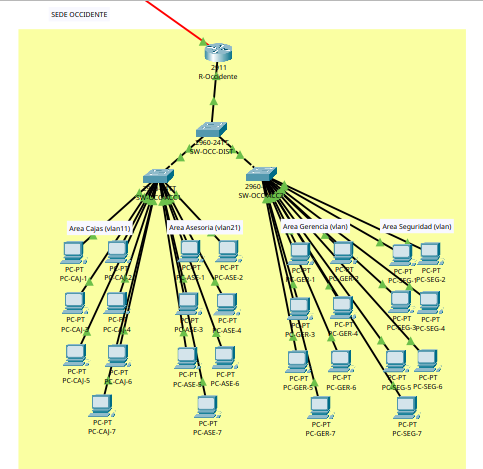

**Necesidad:** que un problema en Asesores no tumbe las cajas.

**Diseño:** estrella jerárquica `R-Occidente` → `SW-OCC-DIST` → `SW-OCC-ACC1` / `SW-OCC-ACC2`.

- Inter-VLAN con **Router-on-a-Stick** (obligatorio)
- **VTP Server** en DIST y **Client** en ACC (`bantech28` / `cisco`)
- Cuatro VLANs de negocio aisladas en L2

VTP permite crear las VLAN una sola vez y replicarlas. Eso responde a la necesidad de una agencia “fácilmente administrable”.

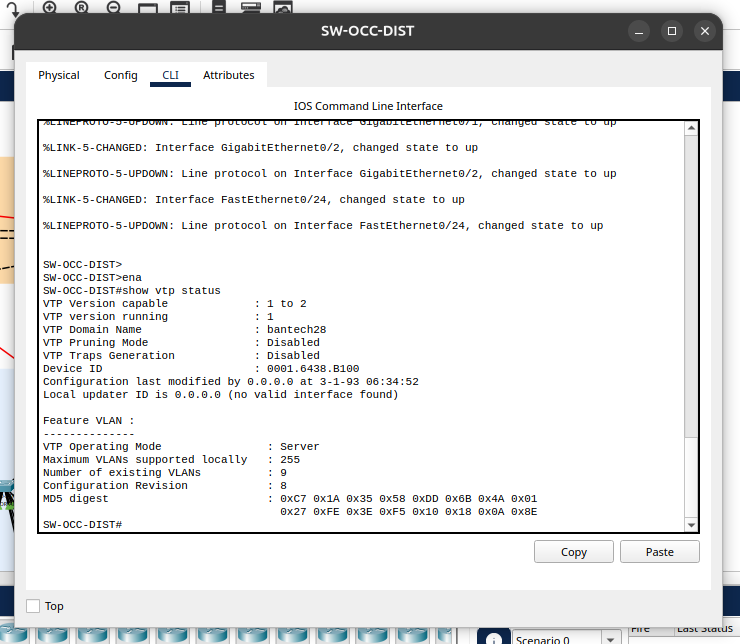

### 7.2 Norte — Centro de Autorización de Créditos

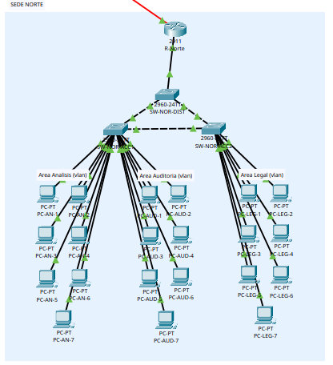

**Necesidad:** no puede haber un único punto de falla físico entre analistas y el switch principal.

**Diseño:** triángulo `SW-NOR-DIST` — `SW-NOR-ACC1` — `SW-NOR-ACC2`.

- Bucles físicos intencionales
- **Rapid PVST+** (`rstp`)
- Root Bridge forzado en `SW-NOR-DIST`

El root se dejó en distribución porque concentra el uplink a `R-Norte`. Si el root estuviera en un acceso, el tráfico de las otras áreas daría un salto extra.

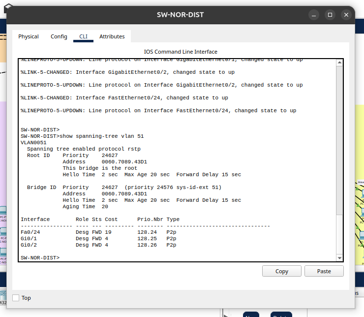

En `SW-NOR-ACC2`, el camino activo es `Fa0/24 Root FWD` y el de respaldo `Fa0/23 Altn BLK`.

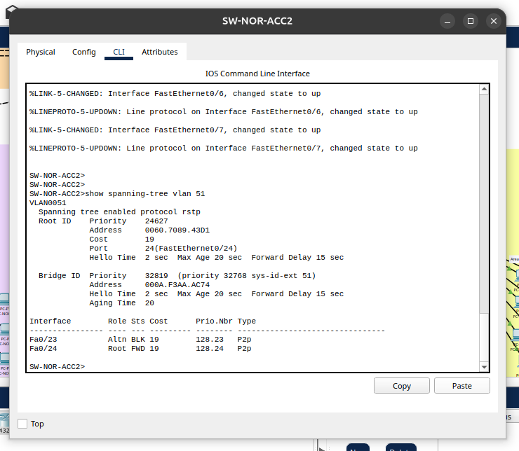

### 7.3 Oriente — Centro Financiero Legado

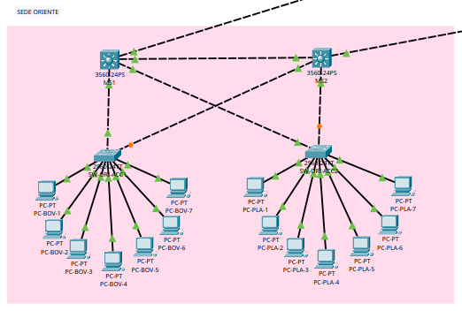

**Necesidad:** los usuarios no pueden perder gateway si `MS1` se apaga.

**Diseño:** access switches conectados a **ambos** multilayer; trunk `MS1`↔`MS2`; **HSRP** por VLAN.

- MS1 Active (prioridad 110 + preempt)
- MS2 Standby (prioridad 90)
- Las PCs usan la VIP, no la IP física del switch

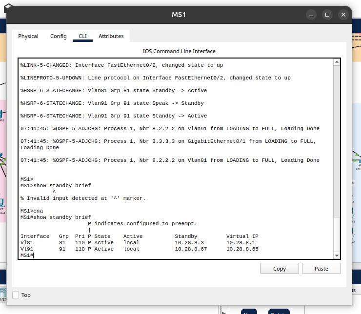

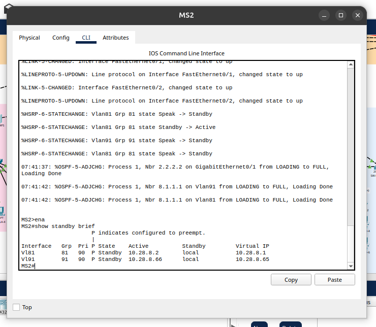

### 7.4 Data Center / Sede Central

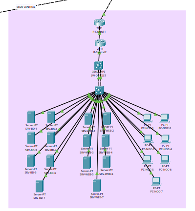

**Necesidad:** sumar capacidad hacia servidores y mantener el DC aislado con estáticas.

**Diseño:** `R-Central1` (redistribución) → `R-Central2` (acceso) → `SW-DC-DIST` ↔ `SW-DC-ACC`.

- EtherChannel **LACP `Po10`** (Fa0/23-24) en 3560
- ROAS en `R-Central2` para VLAN 12, 22 y 32
- Default estática en Central2 hacia Central1
- Central1 anuncia `10.28.12.0/27`, `10.28.12.32/27` y `10.28.12.64/28` a OSPF

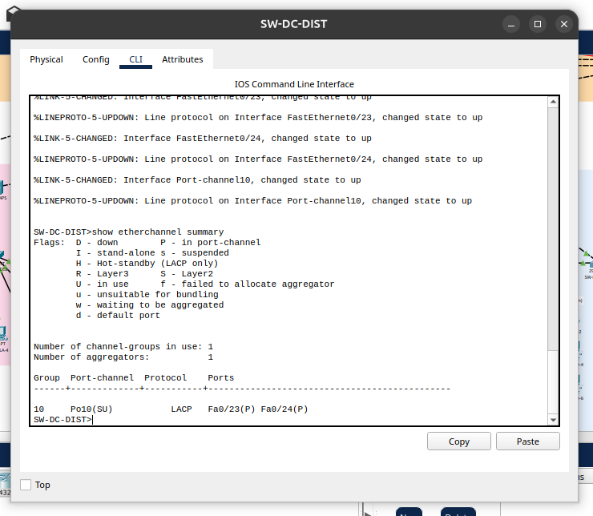

## 8) Extractos de configuración clave

### 8.1 Router-on-a-Stick — `R-Occidente`

```cisco
interface GigabitEthernet0/0.11
 encapsulation dot1Q 11
 ip address 10.28.0.1 255.255.255.192
interface GigabitEthernet0/0.21
 encapsulation dot1Q 21
 ip address 10.28.0.65 255.255.255.192
interface GigabitEthernet0/0.31
 encapsulation dot1Q 31
 ip address 10.28.0.129 255.255.255.240
interface GigabitEthernet0/0.41
 encapsulation dot1Q 41
 ip address 10.28.0.145 255.255.255.240
```

### 8.2 VTP — `SW-OCC-DIST`

```cisco
vtp mode server
vtp domain bantech28
vtp password cisco
vlan 11
 name Cajas
```

### 8.3 Rapid PVST+ y Root — `SW-NOR-DIST`

```cisco
spanning-tree mode rapid-pvst
spanning-tree vlan 51,61,71 root primary
```

### 8.4 HSRP — `MS1` (Active)

```cisco
interface Vlan81
 ip address 10.28.8.2 255.255.255.192
 standby 81 ip 10.28.8.1
 standby 81 priority 110
 standby 81 preempt
```

### 8.5 EtherChannel LACP — Data Center

```cisco
interface range FastEthernet0/23 - 24
 channel-group 10 mode active
interface Port-channel10
 switchport trunk encapsulation dot1q
 switchport mode trunk
```

### 8.6 Redistribución RIP ↔ OSPF — `R-CORE2`

```cisco
router ospf 1
 router-id 2.2.2.2
 redistribute rip subnets
router rip
 version 2
 no auto-summary
 network 10.28.250.12
 redistribute ospf 1 metric 5
```

### 8.7 Redistribución EIGRP ↔ OSPF — `R-CORE3`

```cisco
router ospf 1
 router-id 3.3.3.3
 redistribute eigrp 28 subnets
router eigrp 28
 no auto-summary
 network 10.28.250.16 0.0.0.3
 redistribute ospf 1 metric 1000000 1 255 1 1500
```

### 8.8 Estáticas — `R-Central1` / `R-Central2`

```cisco
! R-Central2
ip route 0.0.0.0 0.0.0.0 10.28.250.33

! R-Central1
ip route 10.28.12.0 255.255.255.224 10.28.250.34
ip route 10.28.12.32 255.255.255.224 10.28.250.34
ip route 10.28.12.64 255.255.255.240 10.28.250.34
router ospf 1
 router-id 4.4.4.4
 network 10.28.250.28 0.0.0.3 area 0
 redistribute static subnets
```

## 9) Pruebas y evidencias

### 9.1 Conectividad extremo a extremo

| Origen | Destino | Resultado |
|---|---|---|
| `PC-CAJ-1` (`10.28.0.2`) | `SRV-BD-1` (`10.28.12.2`) | 4/4 |
| `PC-AN-1` (`10.28.4.2`) | `SRV-BD-1` (`10.28.12.2`) | 4/4 |
| `PC-BOV-1` (`10.28.8.4`) | `SRV-BD-1` (`10.28.12.2`) | 4/4 |
| `PC-CAJ-1` | `PC-ASE-1` (`10.28.0.66`) | 4/4 inter-VLAN |
| `PC-AN-1` | `PC-CAJ-1` (`10.28.0.2`) | 4/4 |

Occidente → Data Center (RIP + OSPF + estáticas):

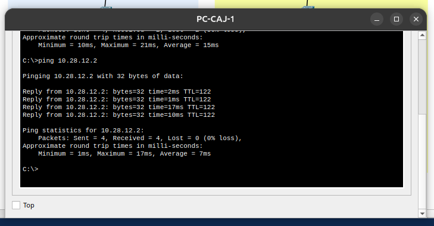

Norte → Data Center (EIGRP + OSPF + estáticas):

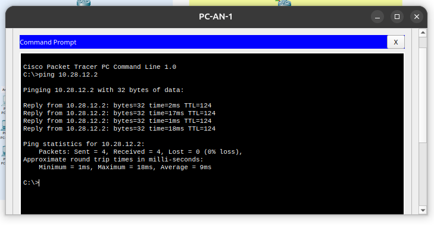

Oriente → Data Center (OSPF + estáticas):

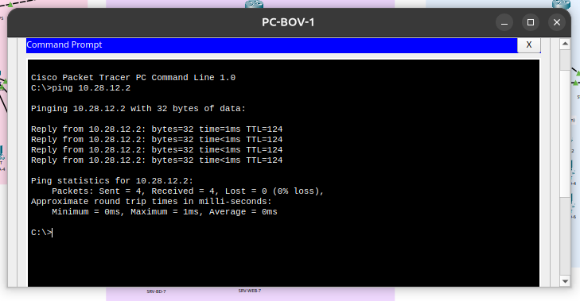

Inter-VLAN en Occidente (Cajas → Asesores):

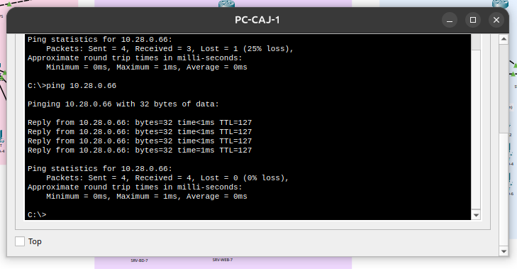

Norte → Occidente:

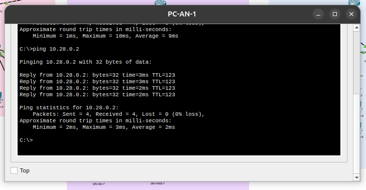

### 9.2 Tablas de enrutamiento y vecinos

`R-Occidente` aprende el resto de la red por **RIP** (`R`), incluyendo Oriente (`10.28.8.0/26`, `10.28.8.64/26`) y el DC (`10.28.12.0/27`, `10.28.12.32/27`). Eso demuestra la redistribución OSPF → RIP en `R-CORE2`.

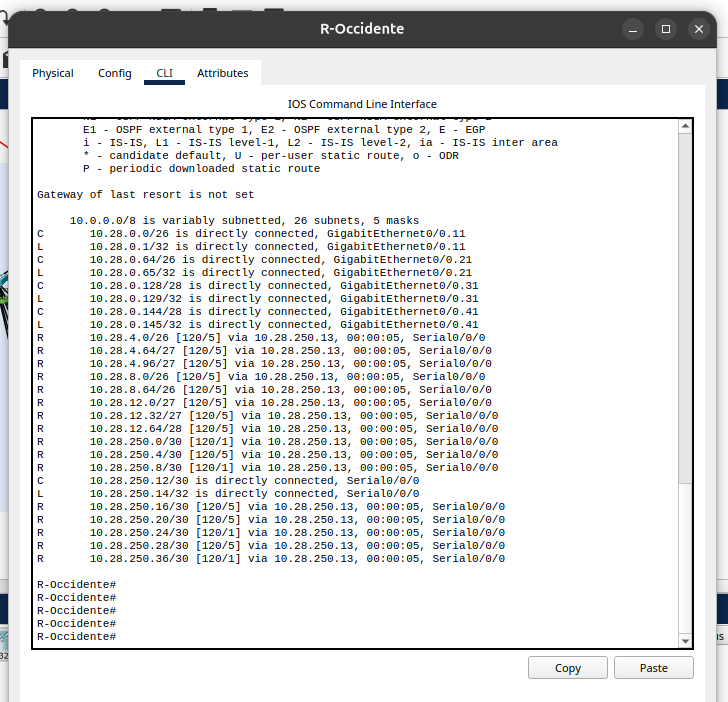

`R-Norte` aprende Occidente, Oriente y DC como **D EX** (EIGRP externo). Eso demuestra EIGRP 28 + redistribución OSPF → EIGRP en `R-CORE3`.

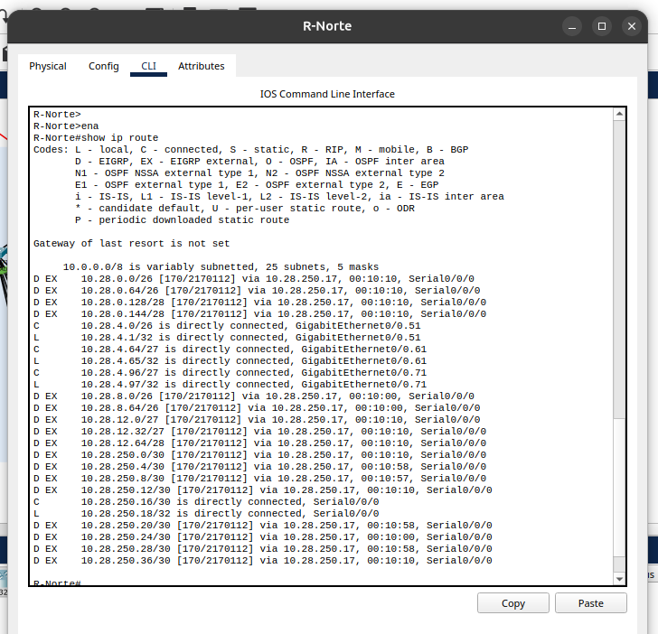

`R-CORE2` mezcla rutas **R** (Occidente) y **O / O E2** (Norte, Oriente, DC).

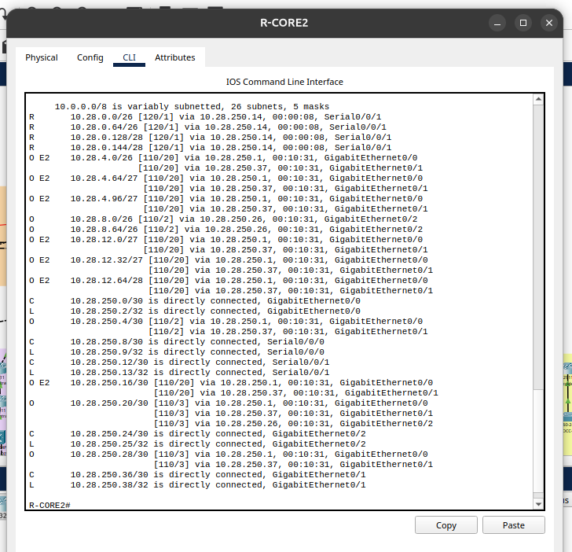

`R-CORE3` mezcla **D** (Norte por EIGRP), **O** (Oriente) y **O E2** (Occidente y DC).

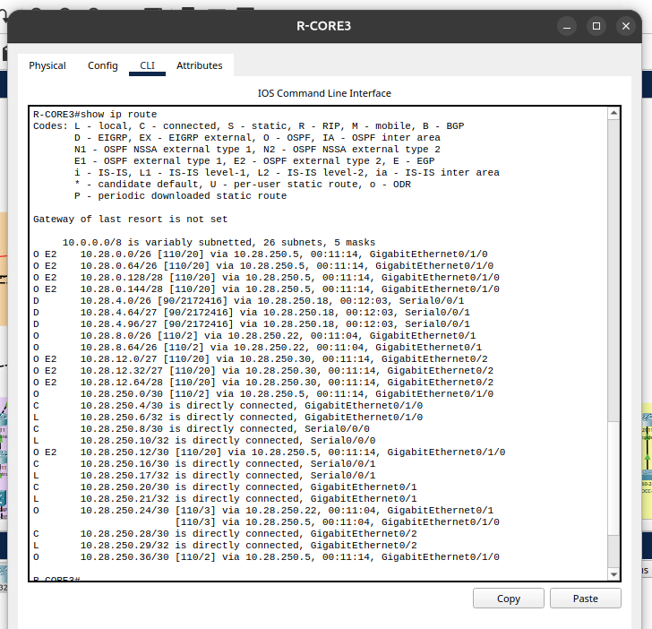

`R-Central1` tiene las tres redes del DC como **S** y el resto como **O / O E2**. El DC no se anuncia con un protocolo dinámico hacia adentro: Central2 solo tiene default estática.

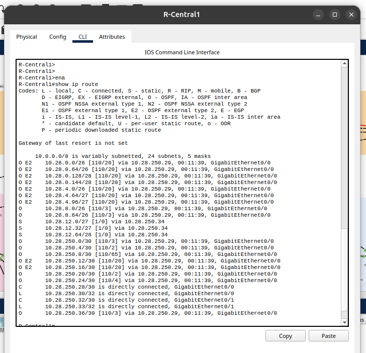

Vecinos OSPF en `R-CORE3`: `MS1` (`8.1.1.1`), `R-Central1` (`4.4.4.4`), `R-CORE2` (`2.2.2.2`) y `R-CORE1` (`1.1.1.1`), todos en FULL.

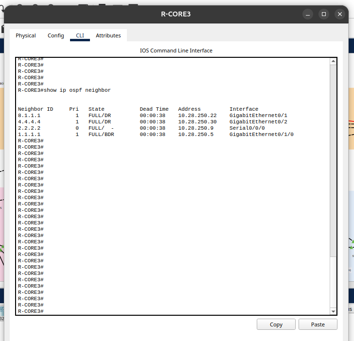

Vecino EIGRP en `R-Norte`: `10.28.250.17` (`R-CORE3`) por `Serial0/0/0`.

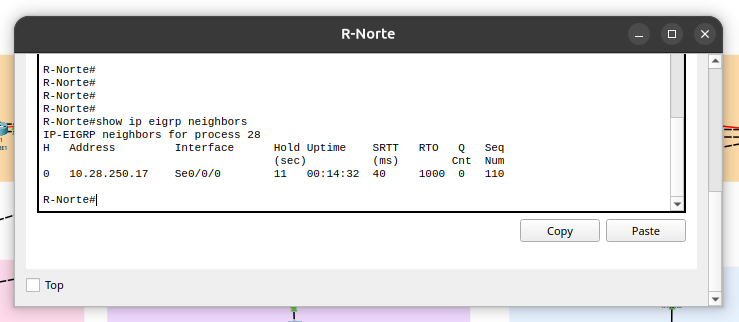

### 9.3 Failover HSRP (Oriente)

**Antes:** `MS1` es Active en VLAN 81 y 91.

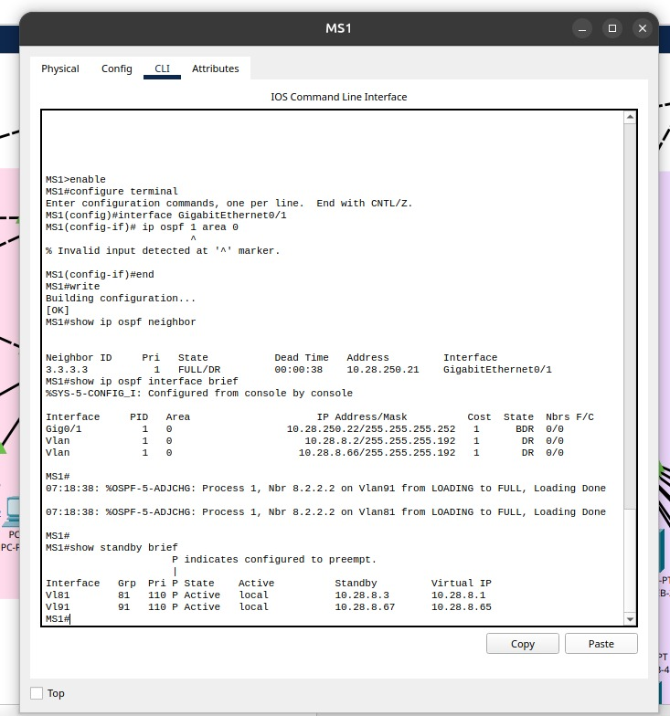

**Durante:** se apagan `Vlan81` y `Vlan91` en `MS1`.

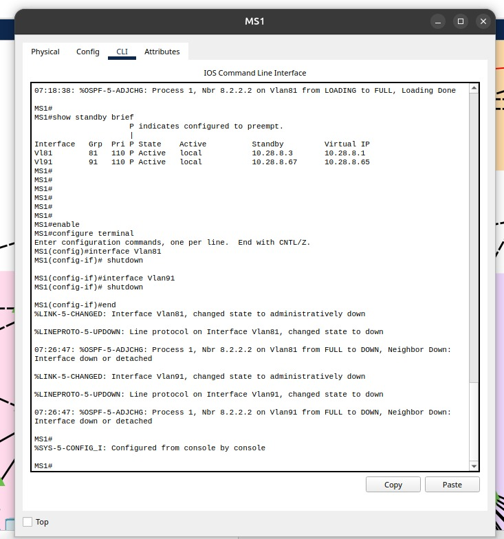

**Resultado:** `MS2` pasa de Standby a **Active** en ambos grupos. El gateway virtual (`10.28.8.1` y `10.28.8.65`) se mantiene; las PCs no cambian IP ni gateway.

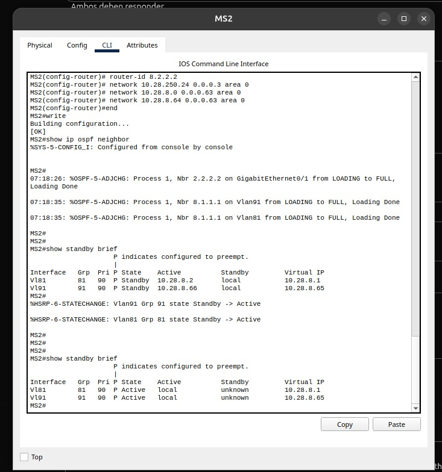

### 9.4 Failover Rapid PVST+ (Norte)

**Antes:** `Fa0/24 Root FWD`, `Fa0/23 Altn BLK`.

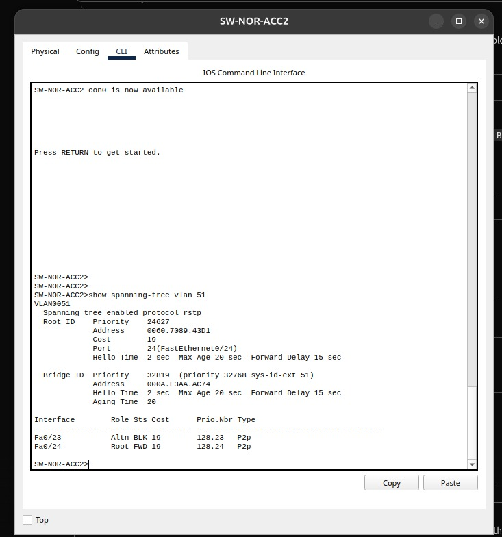

**Durante:** `shutdown` de `Fa0/24`. `Fa0/23` sube a **Root FWD**. El triángulo sigue con camino alterno y sin bucle.

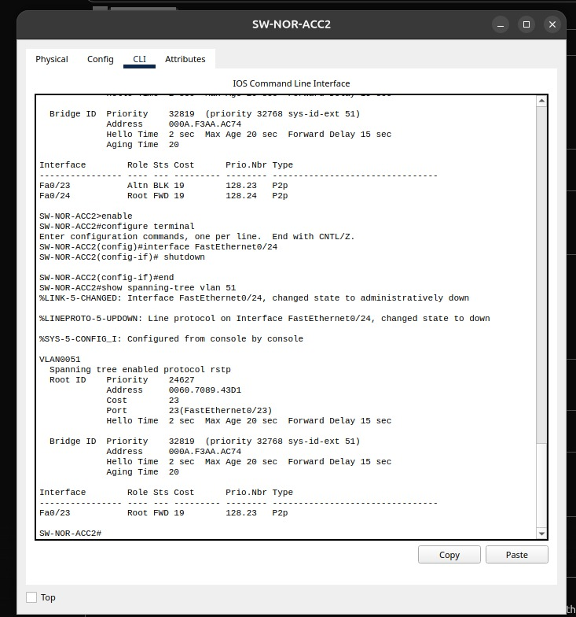

**Restauración:** `Fa0/24` vuelve up. Rapid PVST+ deja `Fa0/23` como Root FWD y `Fa0/24` en BLK: el bucle sigue controlado. No es obligatorio que el puerto original recupere el rol; lo obligatorio es que no haya tormentas y que exista un camino activo.

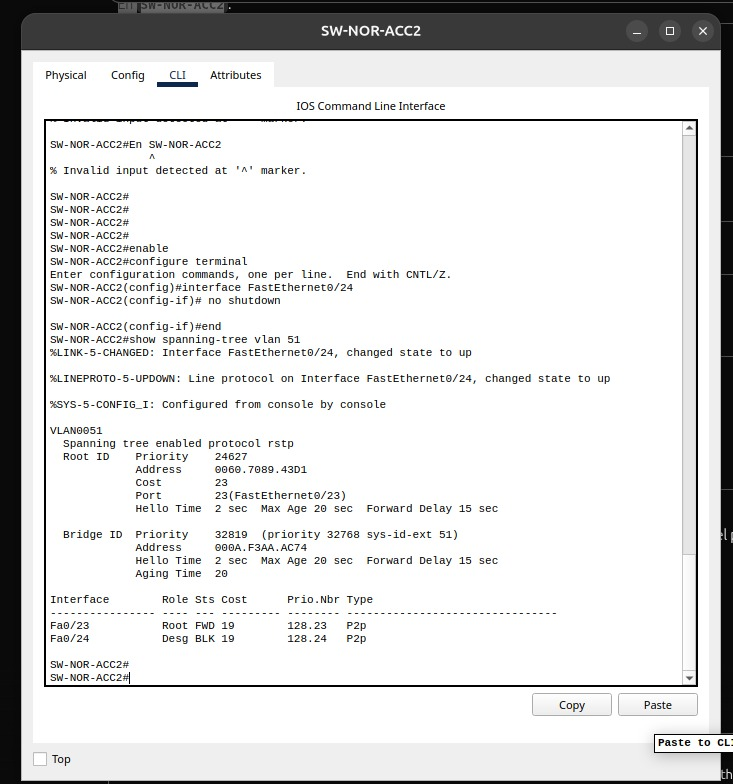

### 9.5 Failover EtherChannel (Data Center)

**Antes:** `Po10(SU)` LACP con `Fa0/23(P)` y `Fa0/24(P)`.

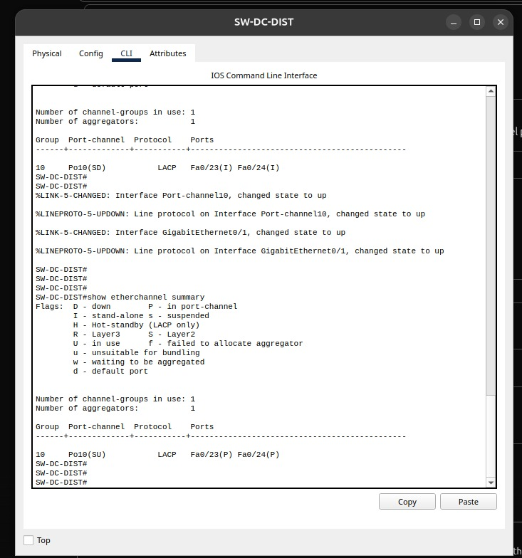

**Durante:** `shutdown` de `Fa0/23`. `Po10` permanece **SU**; el tráfico sigue por `Fa0/24(P)`.

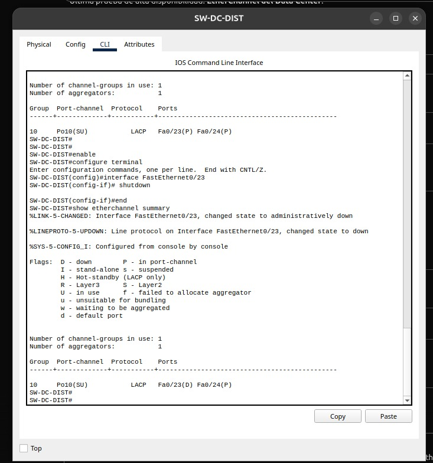

**Restauración:** `no shutdown` en `Fa0/23`. Ambos miembros vuelven a `(P)`.

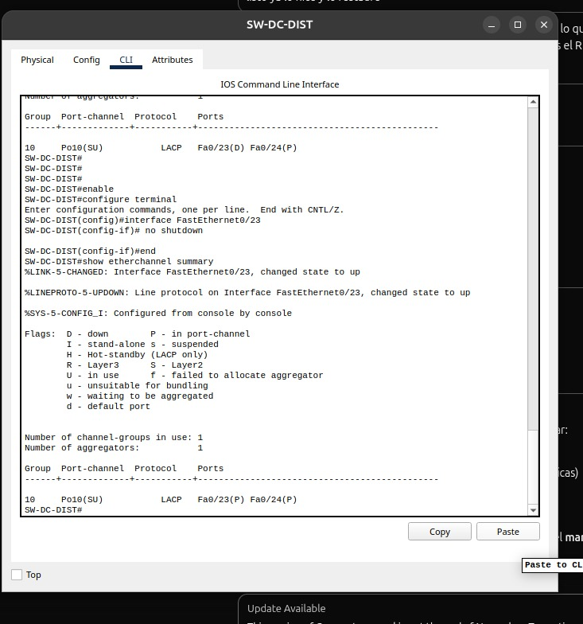

## 10) Mapeo lógico (principal / trunk / access)

| Sede | Equipo principal | Trunks 802.1Q | Access |
|---|---|---|---|
| Occidente | `SW-OCC-DIST` | DIST↔`R-Occidente`, DIST↔ACC1, DIST↔ACC2 | ACC1 Fa0/1-14 (VLAN 11/21), ACC2 Fa0/1-14 (VLAN 31/41) |
| Norte | `SW-NOR-DIST` (Root) | DIST↔`R-Norte` y triángulo entre los 3 SW | ACC1 VLAN 51/61, ACC2 VLAN 71 |
| Oriente | `MS1` (Active HSRP) | MS1↔MS2 y dual-homing a ambos ACC | ACC1 VLAN 81, ACC2 VLAN 91 |
| Central | `SW-DC-DIST` | `Po10` + G0/1 a `R-Central2` | ACC Fa0/1-7 VLAN 12, Fa0/8-14 VLAN 22, Fa0/15-21 VLAN 32 |

## 11) Identificación de protocolos en el simulador

En el `.pkt` cada sede queda marcada así:

- Backbone y Oriente: **OSPF 1 área 0**
- Norte: **EIGRP AS 28**
- Occidente: **RIPv2**
- Central: **rutas estáticas**, redistribuidas en `R-Central1`

## 12) Conclusión

BanTech GT quedó operativa de extremo a extremo: las cuatro sedes se alcanzan, las VLAN están segmentadas con VLSM según `XX=28` y `Y=1`, y la redistribución entre RIP, OSPF, EIGRP y estáticas se ve en las tablas de los routers frontera. La alta disponibilidad se validó apagando el Active de HSRP, un enlace del anillo STP y un miembro de `Po10`; en los tres casos el servicio continuó por el camino de respaldo.
